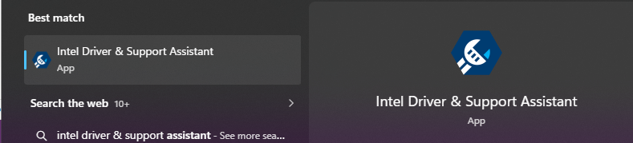
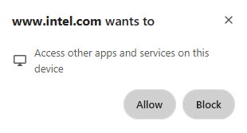
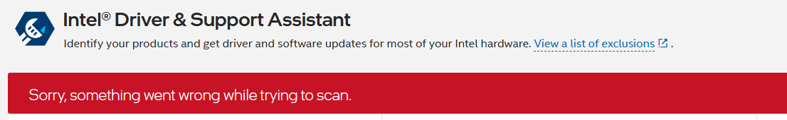
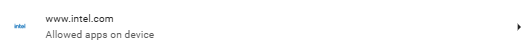
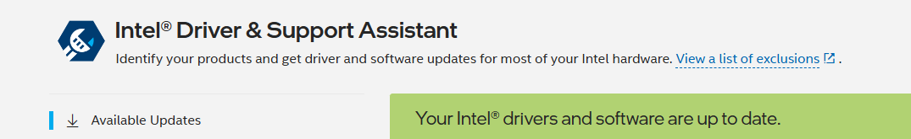

# Least-Privilege Browser Permission Test: Intel Driver & Support Assistant

## Overview

In this lab, I tested whether Intel® Driver & Support Assistant (Intel DSA) required the Norton Private Browser permission **Apps on device** to scan my Windows system. I used a controlled deny-then-allow test: I first blocked the request and recorded the result, then allowed only the relevant permission, refreshed the Intel DSA page, and compared the outcome.

The test showed a repeatable relationship:

- With **Apps on device** blocked, Intel DSA displayed a scan error.
- With **Apps on device** allowed for `www.intel.com`, Intel DSA completed the scan and displayed an up-to-date result.

This was a small functional test, not a security assessment of Intel DSA, Intel, Norton Private Browser, or Windows.

## Objective

My objective was to determine whether Intel DSA genuinely needed the browser's **Apps on device** permission to communicate with its locally installed service and complete a hardware/driver scan.

I also wanted to practice a least-privilege troubleshooting process: begin with access denied, observe the failure mode, grant only the permission associated with the tested function, and verify the result without broadly relaxing unrelated browser permissions.

## Hypothesis

If Intel DSA depends on a locally installed service, blocking **Apps on device** should prevent the Intel website from completing the scan. Allowing that specific permission and refreshing the page should restore the scan while unrelated permissions remain unchanged.

## Environment

| Component | Lab context |
|---|---|
| Host | Personal Windows computer |
| Browser | Norton Private Browser |
| Website | Intel Driver & Support Assistant on `www.intel.com` |
| Local component | Intel Driver & Support Assistant application/service already installed |
| Permission tested | **Apps on device** for `www.intel.com` |
| Test method | Controlled block/allow comparison |

Exact hardware identifiers, account details, browser profile data, serial numbers, device name, network details, and full software inventory are intentionally omitted from this public-facing report.

## Safety and Scope

- I performed the test only on a computer I own and administer.
- I changed one site permission relevant to the test.
- I did not disable antivirus, firewall, browser protections, or unrelated privacy controls.
- I did not install untrusted software or attempt to bypass access controls.
- I treated the Intel page and locally installed Intel DSA component as the system under test.
- I did not capture or publish a full diagnostic report because it could disclose detailed device information.

## Procedure

These steps document the sequence I followed and are written to be repeatable on an authorized Windows system.

1. I confirmed that Intel DSA was already installed on my computer.

   

2. I opened the Intel DSA support page in Norton Private Browser.
3. The browser prompted me to let `www.intel.com` **access other apps and services on this device**.

   

4. I selected **Block** for the first test condition.

   

5. I allowed the page to attempt its scan and observed the result.
6. Intel DSA displayed: **“Sorry, something went wrong while trying to scan.”**

   

7. I opened the site-specific permissions for `www.intel.com`.
8. I changed only **Apps on device** to **Allow**. I left the other site permissions at their existing settings.

   

9. I returned to the Intel DSA page and refreshed it.
10. Intel DSA completed the scan and displayed a green status indicating that the Intel drivers and software were up to date.

    

11. I compared the two outcomes and documented the dependency indicated by the test.

## Results and Observations

| Test condition | Action | Observation | Interpretation |
|---|---|---|---|
| Block/fail | Denied the request to access other apps and services on the device | Intel DSA reported that something went wrong while trying to scan | The browser page could not complete the expected interaction while access was denied |
| Allow/success | Set **Apps on device** to **Allow**, returned to Intel DSA, and refreshed | The scan completed and the page displayed a green up-to-date status | The permission appears necessary for this Intel DSA browser-to-local-service workflow |

### Evidence references

| Evidence ID | File | Purpose |
|---|---|---|
| E1 | [`01-intel-desktop-app-installed.png`](evidence/01-intel-desktop-app-installed.png) | Confirms the local Intel DSA application was installed |
| E2 | [`02-permission-prompt-sanitized.png`](evidence/02-permission-prompt-sanitized.png) | Records the browser's device-access request and the **Allow**/**Block** choices |
| E3 | [`03-blocked-scan-error-sanitized.png`](evidence/03-blocked-scan-error-sanitized.png) | Records the failed scan after access was blocked |
| E4 | [`04a-blocked-apps-on-device-sanitized.png`](evidence/04a-blocked-apps-on-device-sanitized.png) | Confirms the blocked test condition |
| E5 | [`04b-allowed-apps-on-device-sanitized.png`](evidence/04b-allowed-apps-on-device-sanitized.png) | Confirms the allowed test condition |
| E6 | [`05-scan-success-sanitized.png`](evidence/05-scan-success-sanitized.png) | Records the successful scan after access was allowed and the page refreshed |

Only sanitized derivatives are included in this repository. The uncropped source captures remain private.

## Analysis

The deny-then-allow comparison supports my hypothesis. The scan failed when the browser could not access the required on-device component, then succeeded after I allowed the specific site permission and refreshed the page. Because the permission change was the main controlled variable, the result is consistent with Intel DSA requiring browser-mediated access to its local application or service.

This test demonstrates functional necessity, not unrestricted trust. It does not prove exactly which local process, interface, port, or protocol was used, and it does not establish that every action available through the permission is required. A deeper validation would require service logs, browser diagnostics, or network/process monitoring.

## Least-Privilege Conclusion

I began with the permission blocked, observed the effect, and then granted only the permission needed for the intended scan. I did not broadly enable unrelated capabilities such as location, camera, microphone, USB devices, serial ports, or file editing.

For ongoing use, I would keep the permission scoped to the legitimate Intel domain, use Intel DSA only when needed, and review or revoke the permission after the task if continuous access is unnecessary. I would also verify the domain and software source before approving a similar prompt. This approach balances functionality with least privilege: access is granted narrowly, for a known purpose, after its necessity has been tested.

## Limitations

- This was one test on one Windows computer and one browser configuration.
- I performed one observed block/allow cycle; repeated trials would strengthen confidence.
- A page refresh occurred after the permission change, so refresh/session state may also have influenced recovery.
- I did not independently verify the local Intel service state before and after each condition.
- I did not collect packet captures, process-monitoring data, service logs, or browser developer diagnostics.
- The wording and behavior of this browser permission may change between browser versions.
- The result shows correlation under the tested conditions and strongly suggests dependency, but it does not prove the internal implementation.
- The green result confirms that the scan completed and reported status; it is not an independent audit of every installed driver.

## CompTIA Security+ and CySA+ Skill Mapping

This lab is a portfolio exercise aligned to certification concepts; it is not an official CompTIA performance-based question and does not claim certification credit.

### CompTIA Security+ alignment

- **Security architecture and principles:** applied least privilege and minimized permissions.
- **Security operations:** changed and reviewed a security-relevant browser setting, validated expected behavior, and documented the outcome.
- **Threats, vulnerabilities, and mitigations:** considered the risk of granting a website access to a local service and limited the trust boundary to a known vendor domain.
- **Troubleshooting and change validation:** used a controlled before/after test instead of enabling multiple permissions at once.
- **Data protection:** identified sensitive information in screenshots and planned sanitization before public release.

### CompTIA CySA+ alignment

- **Security operations:** established a hypothesis, changed one variable, collected observable evidence, and compared results.
- **Vulnerability management:** evaluated whether a requested permission was functionally necessary and considered the exposure created by that permission.
- **Incident-response-style analysis:** recorded conditions, symptoms, actions, results, scope, and limitations in a repeatable timeline.
- **Reporting and communication:** translated technical observations into evidence, findings, risk considerations, and recommendations suitable for review.
- **Evidence handling:** retained private originals while planning sanitized derivatives for public reporting.

## Recommendations and Next Steps

1. Repeat the block/allow cycle in a future test to strengthen reproducibility.
2. Record the browser version, Windows edition/build, and Intel DSA version privately; disclose only generalized versions publicly if needed.
3. Optionally check the Intel DSA service state or logs to strengthen the explanation of the local dependency.
4. Preview the repository exactly as it will appear publicly before publishing.

## Key Takeaway

This lab showed me that a permission prompt should be evaluated in context rather than automatically accepted or permanently denied. By starting with access blocked, observing the failure, allowing only the relevant permission, and validating the successful result, I confirmed a functional dependency while following a least-privilege approach.

---

*Product and company names are used only to describe the lab environment. Intel® is a trademark of Intel Corporation or its subsidiaries. Norton is a trademark of its respective owner.*
