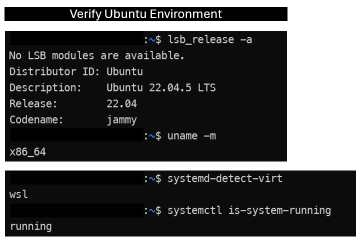
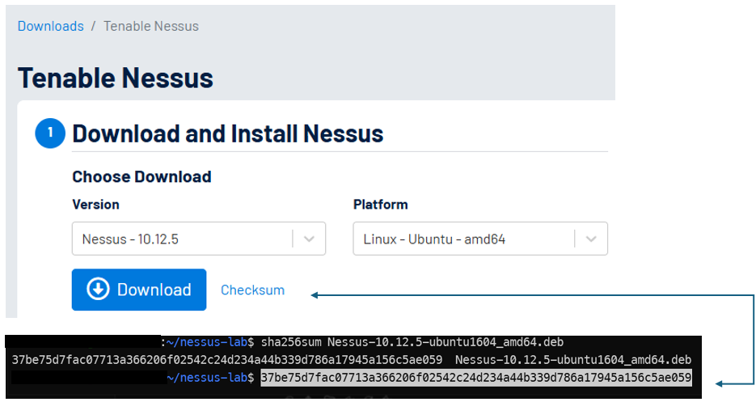

# Nessus Essentials Plus: Installation, PKI Configuration & HTTPS Security Hardening

## Executive Summary

In this lab, I installed and configured Tenable Nessus Essentials Plus on an Ubuntu 22.04 LTS environment running through Windows Subsystem for Linux (WSL2).

My initial objective was to create a vulnerability scanning environment that I could use while studying CompTIA CySA+ and completing Hack The Box training modules.

During installation, I identified opportunities to improve the security of the Nessus management interface. I expanded the exercise to include software integrity verification, Linux service administration, network exposure reduction, Public Key Infrastructure (PKI), certificate management, and TLS authentication.

By the end of the exercise, I had successfully:

- Installed Nessus Essentials Plus 10.12.5.
- Verified the installer against Tenable's published SHA-256 checksum.
- Configured and validated the Nessus Linux service.
- Restricted the web management interface to the IPv4 loopback address.
- Generated a dedicated local Certificate Authority and signed server certificate.
- Configured the certificate with a valid Subject Alternative Name.
- Verified the certificate chain using OpenSSL.
- Imported the replacement certificate into Nessus.
- Configured certificate trust in Windows.
- Confirmed that Chrome could access the Nessus dashboard without certificate-authority warnings.

This was a software deployment and security-hardening exercise conducted on a personally administered system. Vulnerability scanning and findings analysis are outside the scope of this particular lab.

---

## 1. Lab Objectives

I established five primary objectives:

1. Deploy a functional Nessus vulnerability scanning platform for future cybersecurity exercises.
2. Practice cryptographic integrity verification before installing downloaded software.
3. Identify and restrict unnecessary network exposure on the Nessus management interface.
4. Understand and implement PKI-based TLS authentication between Nessus and my Windows browser.
5. Validate each configuration change and document the resulting security improvements.

## 2. Lab Environment

| Component | Configuration |
|---|---|
| Host operating system | Windows 11 |
| Linux environment | Ubuntu 22.04.5 LTS |
| Virtualization | WSL2 |
| Processor architecture | x86_64 |
| Linux service manager | systemd |
| Vulnerability scanner | Tenable Nessus Essentials Plus 10.12.5 |
| License | Educational Essentials Plus, 20-IP allowance |
| TLS toolkit | OpenSSL 3.0.2 |
| Management interface | HTTPS, TCP 8834 |
| Browser | Google Chrome |
| Certificate management | Windows Certificate Manager and PowerShell |

This lab was performed on a personal workstation. Hardware identifiers, account credentials, residential information, activation codes, and private cryptographic keys are excluded from this public documentation.

## 3. Scope and Security Considerations

I performed all installation and configuration activities on a system I own and administer.

My scope included the local Ubuntu environment, its Nessus service, the Windows-to-WSL management connection, and the associated TLS certificate configuration.

I did not conduct vulnerability scans against external systems, third-party networks, or unauthorized targets.

Security precautions included:

- Downloading software from Tenable's official distribution source.
- Comparing cryptographic checksums before installation.
- Using elevated privileges only for administrative operations.
- Preserving the original Nessus certificates before making changes.
- Restricting administrative access to the loopback interface.
- Protecting CA and server private keys in root-only directories.
- Verifying certificate fingerprints before establishing trust.
- Retaining rollback options throughout the configuration process.

## 4. Methodology

### Phase 1 — Verify the Ubuntu Environment

Before installation, I verified my Ubuntu version, processor architecture, virtualization environment, and service manager.

```bash
lsb_release -a
uname -m
systemd-detect-virt
systemctl is-system-running
```
**Evidence 01 — Ubuntu Environment Verification**



*Figure 1. Ubuntu environment verification confirming Ubuntu 22.04.5 LTS, x86_64 architecture, WSL virtualization, and an operational systemd service manager.*

**Result:** The Linux environment met the initial requirements for attempting the Nessus deployment.

### Phase 2 — Download and Verify the Installer

I created a dedicated workspace:

```bash
mkdir -p ~/nessus-lab
cd ~/nessus-lab
```

I downloaded the Nessus Ubuntu AMD64 Debian package from Tenable's official distribution service.

Before installing the package, I confirmed that Linux recognized it as a Debian binary package:

```bash
ls -lh Nessus-*.deb
file Nessus-*.deb
```

I then calculated the SHA-256 hash:

```bash
sha256sum Nessus-10.12.5-ubuntu1604_amd64.deb
```

I independently obtained the expected checksum through Tenable's official download page.

**Evidence 02 — SHA-256 Installer Integrity Verification**



*Figure 2. SHA-256 checksum generated in Ubuntu compared with the vendor-published SHA-256 checksum obtained from Tenable's official download page. Both values matched exactly.*

This provided evidence that the downloaded package matched the vendor's published checksum. I recognized that checksum verification is an integrity control and does not, by itself, constitute malware analysis.

### Phase 3 — Install and Initialize Nessus

After verifying the package integrity, I installed it:

```bash
sudo apt install ./Nessus-10.12.5-ubuntu1604_amd64.deb
```

The installation reported that its cryptographic self-tests passed and successfully registered the Nessus systemd service.

I started the scanner and checked its status:

```bash
sudo systemctl start nessusd
systemctl status nessusd --no-pager
```

**Result:** `nessusd.service` reported `active (running)`.

I also investigated a nonfatal APT warning indicating that the `_apt` sandbox account could not access the installation package in my home directory. The package had been installed successfully using elevated privileges.

### Phase 4 — Inspect Management Network Exposure

I examined the Nessus listening sockets:

```bash
sudo ss -tlnp | grep 8834
```

Initially, the service was listening on:

```text
0.0.0.0:8834
[::]:8834
```

These bindings indicated that Nessus was accepting connections on all available IPv4 and IPv6 interfaces inside the Ubuntu environment.

Because I intended to administer the scanner locally, this was broader exposure than required.

I confirmed its configured address:

```bash
sudo /opt/nessus/sbin/nessuscli fix --get listen_address
```

The value was `0.0.0.0`.

I then restricted the management listener:

```bash
sudo /opt/nessus/sbin/nessuscli fix --set listen_address=127.0.0.1
sudo systemctl restart nessusd
```

After restarting the service, I verified that Nessus was listening on:

```text
127.0.0.1:8834
```

I also confirmed that Chrome on the Windows host could still reach and authenticate to the Nessus web interface.

**Finding:** I reduced the listener's interface exposure while preserving the required local management workflow.

This test verified the local listening configuration, but did not constitute an independent reachability test from another device on my home network.

### Phase 5 — Investigate the HTTPS Certificate Warning

On the initial installation, Chrome reported:

```text
NET::ERR_CERT_AUTHORITY_INVALID
```

I inspected the TLS certificate presented by the Nessus service using OpenSSL:

```bash
echo | openssl s_client \
  -connect 127.0.0.1:8834 \
  -servername localhost \
  2>/dev/null | openssl x509 \
  -noout -subject -issuer -dates \
  -fingerprint -sha256
```

My investigation established that the original server certificate was issued by a private Nessus Certificate Authority and identified the workstation hostname rather than `localhost`.

A separate inspection did not reveal a Subject Alternative Name extension.

I concluded that two certificate requirements needed attention:

1. The server certificate needed to identify `localhost`.
2. Windows and Chrome needed an appropriate trust relationship with the issuing CA.

I did not resolve this problem by disabling TLS verification or switching the management interface to unencrypted HTTP.

### Phase 6 — Back Up Existing Certificates

Before replacing the active Nessus certificate, I created a root-only backup directory:

```bash
sudo install -d -m 700 /root/nessus-cert-backup
```

I backed up the existing CA certificate, server certificate, and their associated private keys.

I assigned permission `600` to the backup files.

During this process, I encountered a Bash wildcard-expansion issue when attempting to change permissions on files under `/root` from my ordinary user shell.

I resolved it by supplying explicit filenames to `sudo chmod`.

**Lesson learned:** Shell wildcard expansion occurs before `sudo` executes the command. Elevated execution privileges do not automatically grant elevated permissions to the calling shell.

### Phase 7 — Create a Dedicated Local Certificate Authority

I created a protected PKI workspace:

```bash
sudo install -d -m 700 /root/nessus-local-pki
```

Using OpenSSL, I generated a 3072-bit RSA CA key and a self-signed CA certificate.

The CA configuration included:

```text
Basic Constraints:
    CA:TRUE, pathlen:0

Key Usage:
    Certificate Sign, CRL Sign
```

I verified these extensions using OpenSSL.

The CA signing key remained protected inside the Ubuntu environment.

### Phase 8 — Generate and Sign a Server Certificate

I generated a separate 3072-bit RSA server private key and a Certificate Signing Request identifying `localhost`.

The server certificate extension configuration included:

```ini
basicConstraints=critical,CA:FALSE
keyUsage=critical,digitalSignature,keyEncipherment
extendedKeyUsage=serverAuth
subjectAltName=DNS:localhost,IP:127.0.0.1
```

I signed the certificate using the dedicated Nessus Local Lab CA.

I verified its certificate chain, intended purpose, and hostname using:

```bash
sudo openssl verify \
  -CAfile /root/nessus-local-pki/ca.crt \
  -purpose sslserver \
  -verify_hostname localhost \
  /root/nessus-local-pki/server.crt
```

OpenSSL returned:

```text
/root/nessus-local-pki/server.crt: OK
```

I separately verified the Subject Alternative Name:

```text
DNS:localhost, IP Address:127.0.0.1
```

**Result:** The replacement certificate passed chain, purpose, and hostname verification against my local CA.

### Phase 9 — Import the Replacement Certificate

I used Tenable's certificate-import utility:

```bash
sudo /opt/nessus/sbin/nessuscli import-certs \
  --serverkey=/root/nessus-local-pki/server.key \
  --servercert=/root/nessus-local-pki/server.crt \
  --cacert=/root/nessus-local-pki/ca.crt
```

The utility confirmed the successful import.

I restarted Nessus and verified that the service was active.

I then connected to TCP 8834 using OpenSSL and confirmed that the running service presented the newly generated certificate with the intended subject, issuer, and SAN values.

### Phase 10 — Configure Certificate Trust in Windows

I exported only the public server certificate and CA certificate to Windows.

The private signing keys were not exported.

Using Windows Certificate Manager and PowerShell, I inspected the certificate properties, including the subject, issuer, intended purpose, and SAN extension.

I initially imported the individual Nessus server certificate into the Local Machine Trusted People store.

Chrome continued displaying:

```text
NET::ERR_CERT_AUTHORITY_INVALID
```

This demonstrated that the initial Windows import did not establish a trust configuration accepted by Chrome.

I subsequently prepared the public CA certificate for import into the Current User Trusted Root Certification Authorities store.

Before approving the trust operation, I compared the SHA-1 certificate thumbprint displayed by Windows against the certificate fingerprint calculated by OpenSSL.

The fingerprints matched.

After establishing the user-scoped CA trust relationship and reopening Chrome, I successfully accessed:

```text
https://localhost:8834
```

without the previous certificate-authority warning.

**Result:** Chrome accepted the configured certificate chain, and the Nessus management dashboard remained accessible.

---

## 5. Results and Validation

| Validation objective | Result |
|---|---|
| Nessus package checksum matched official reference | Passed |
| Installation and service initialization | Passed |
| Educational license activation | Completed |
| Vulnerability plugin initialization | Completed |
| Management listener restricted to loopback | Passed |
| Certificate and private-key backup | Completed |
| Local CA certificate extensions | Verified |
| Server certificate hostname and SAN | Verified |
| OpenSSL certificate-chain validation | Passed |
| Nessus custom certificate import | Passed |
| Windows certificate trust configuration | Completed |
| Chrome certificate-authority warning eliminated | Passed |

The final result was a functioning Nessus Essentials Plus installation with a locally restricted management interface and a trusted HTTPS certificate for `localhost`.

## 6. Security Findings and Remediation

### Finding 1 — Broad management interface binding

**Observation:** Nessus initially listened on all available IPv4 and IPv6 interfaces.

**Potential risk:** A management service bound to multiple interfaces may have a larger reachable attack surface, depending on the host networking configuration and firewall controls.

**Remediation:** I configured `listen_address=127.0.0.1`.

**Validation:** Socket inspection confirmed the loopback-only listener, and Windows browser access continued working.

### Finding 2 — Untrusted TLS certificate

**Observation:** Chrome reported `NET::ERR_CERT_AUTHORITY_INVALID` when connecting to the Nessus web interface.

**Potential risk:** Unverified certificate identity prevents the browser from reliably authenticating the intended HTTPS endpoint.

**Remediation:** I generated a new server certificate with an appropriate SAN and established trust in its dedicated local CA.

**Validation:** OpenSSL verified the certificate chain, and Chrome subsequently accepted the HTTPS connection without the earlier certificate warning.

### Finding 3 — Certificate Authority trust requires lifecycle management

**Observation:** Establishing trust in a local CA allows that CA to authenticate certificates it signs.

**Security consideration:** CA private-key protection and trust-store scope are essential. A compromised trusted CA key could enable fraudulent certificate issuance.

**Controls:** I restricted private-key access, retained backups, and installed CA trust at the Windows Current User scope.

**Future maintenance:** Renew or replace the certificates before their October 2027 expiration and remove the CA from trusted stores when the lab is retired.

## 7. Troubleshooting and Lessons Learned

This exercise reinforced several important technical concepts.

**Linux permissions:** I learned how directory permissions, file permissions, ownership, and shell wildcard expansion interact with `sudo`.

**Network security:** I used `ss` to distinguish a service listening on all interfaces from one bound to loopback. I also learned that a socket binding alone does not establish end-to-end network reachability.

**PKI:** I practiced creating a CA, generating a CSR, signing an X.509 server certificate, configuring extensions, and validating a certificate chain.

**TLS authentication:** I learned that an encrypted HTTPS connection can still fail identity verification when the certificate issuer is untrusted or the hostname is incorrect.

**Change management:** I preserved original certificates, verified changes before deployment, and maintained a recovery path.

**Troubleshooting methodology:** I isolated configuration problems one at a time instead of disabling security controls to bypass an error.

## 8. Relevance to Cybersecurity Operations

This lab supports several skills applicable to SOC Analyst, Cybersecurity Analyst, and Vulnerability Analyst roles.

| Competency | Practical application |
|---|---|
| Vulnerability management | Deploying and maintaining an authorized scanning platform |
| Linux administration | Managing services, permissions, and configuration |
| Network security | Evaluating interface bindings and exposed services |
| Cryptography and PKI | Validating certificates, chains, and trust relationships |
| Security hardening | Reducing unnecessary administrative exposure |
| Troubleshooting | Investigating errors and validating remediation |
| Documentation | Preserving evidence and communicating technical outcomes |

The Nessus scanner is now prepared for future vulnerability management exercises. This lab does not claim that a vulnerability assessment was conducted or that vulnerabilities were discovered.

## 9. Evidence and Public Disclosure Controls

Supporting screenshots will be stored in the `evidence/` directory after review and sanitization.

Planned evidence includes:

| Evidence file | Description |
|---|---|
| [01-environment-verification.png](evidence/01-environment-verification.png) | Ubuntu version, architecture, and WSL validation |
| `02-installer-integrity.png` | SHA-256 package integrity verification |
| `03-service-validation.png` | Successful Nessus service initialization |
| `04-listener-hardening.png` | Nessus management listener bound to loopback |
| `05-pki-validation.png` | Certificate-chain and SAN verification |
| `06-certificate-import.png` | Successful Nessus certificate import |
| `07-https-validation.png` | Final Nessus dashboard without the Chrome certificate warning |

I will exclude the following from the public repository:

- License activation codes and registration references.
- Passwords, tokens, session identifiers, and authentication material.
- CA and server private keys.
- Personal addresses, private email addresses, and other unnecessary identifying information.
- Screenshots containing security-sensitive information that has not been sanitized.
- Complete private network topology or detailed configuration information unnecessary to demonstrate the lab.

No cryptographic private keys will be committed.

## 10. Next Steps

The next exercise will focus on the vulnerability assessment workflow:

1. Select an explicitly authorized test target.
2. Define scan scope and an appropriate Nessus scan policy.
3. Perform host discovery and a controlled initial scan.
4. Review findings and distinguish confirmed issues from potential false positives.
5. Analyze CVE identifiers, CVSS severity, and remediation recommendations.
6. Document findings and any remediation validation in a separate portfolio lab.

## 11. References

- [Tenable Nessus Downloads](https://www.tenable.com/downloads/nessus)
- [Tenable Nessus Documentation](https://docs.tenable.com/nessus/)
- [OpenSSL Documentation](https://docs.openssl.org/)
- [Microsoft WSL Documentation](https://learn.microsoft.com/en-us/windows/wsl/)
- [Microsoft Certificate Management Documentation](https://learn.microsoft.com/en-us/windows/)

---

**Lab completion:** October 19, 2026  
**Category:** Vulnerability Management / System Hardening / PKI  
**Environment:** Personal authorized cybersecurity laboratory  
**Status:** Installation and HTTPS security-hardening objectives completed
